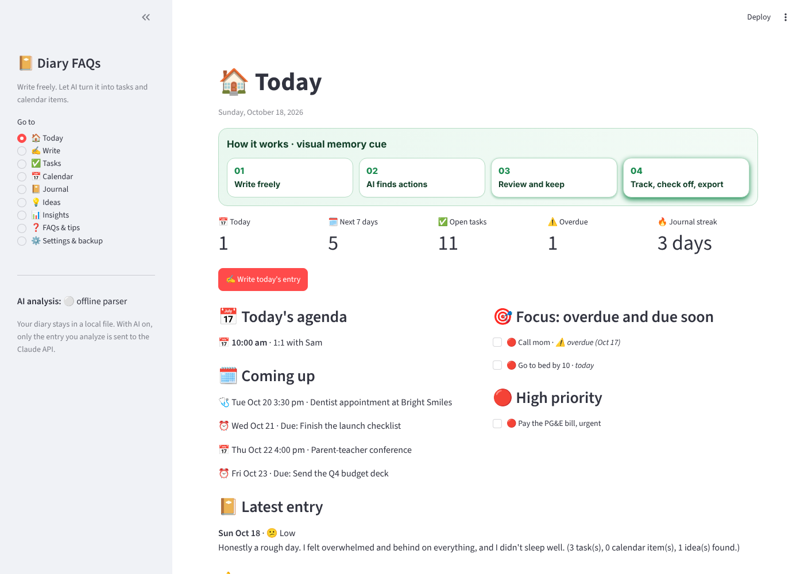
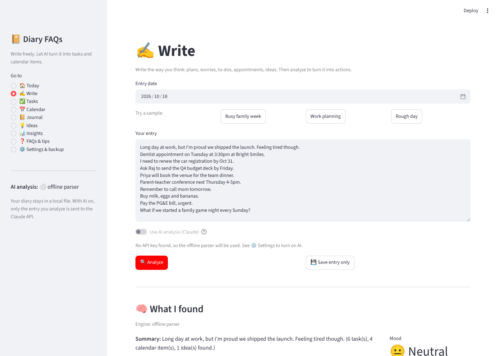
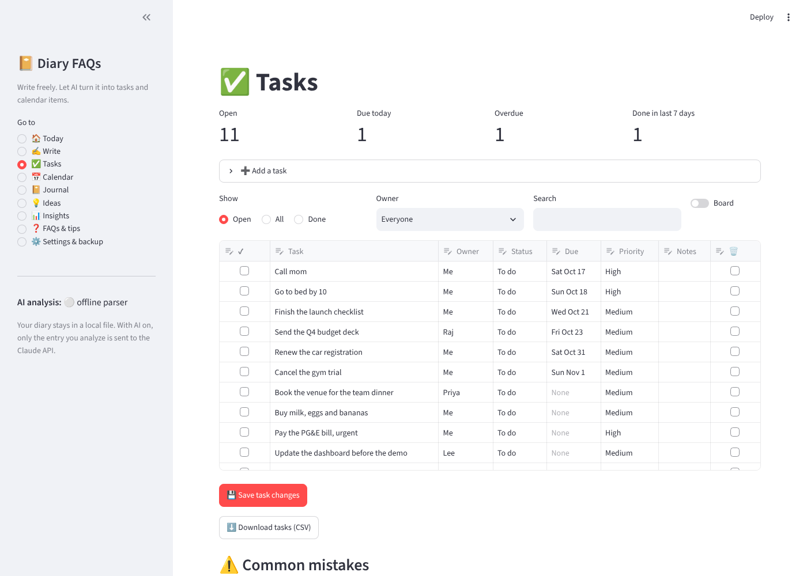
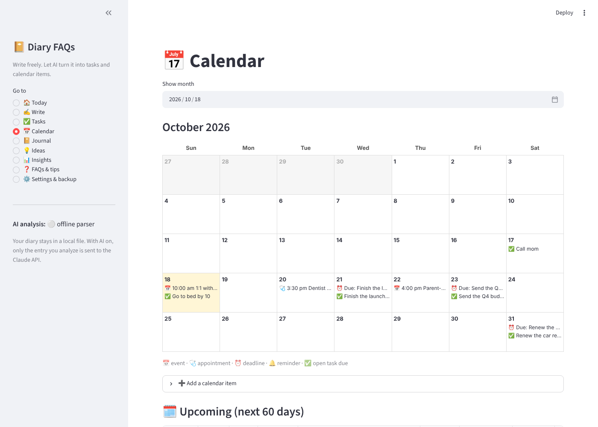

# 📔 Diary FAQs

A Streamlit diary where you write freely and the app turns your writing into action. AI analysis (Claude) reads each entry and pulls out appointments, events and due dates for a **calendar**, to-dos for a **task list** with a done checkbox, status, owner, due date and priority, plus ideas, a mood score, tags and a short summary. Without an API key, an offline parser does the same job for common phrasing, so the app always works.



## How it works

1. **Write** the way you think: "Dentist on Tuesday at 3:30pm. Need to renew the car registration by Oct 31. Ask Raj to send the deck by Friday."
2. **Analyze.** Claude (or the offline parser) returns a summary, mood, tags, tasks, calendar items and ideas.
3. **Review and keep.** Everything shows up in editable tables. Untick what you don't want, fix a date or owner, then save.
4. **Track and export.** Check off tasks, move them through statuses, see the month calendar, and download an `.ics` file for Google, Apple or Outlook calendar.

## Pages

- 🏠 **Today**: today's agenda, the next 7 days, overdue and due-soon tasks with checkboxes, high-priority tasks, journal streak and the latest entry.
- ✍️ **Write**: entry date, three sample entries, the AI toggle, Analyze, and review tables for tasks, calendar items and ideas before saving.
- ✅ **Tasks**: an editable table with ✔ done checkbox, task, owner, status (To do, In progress, Waiting, Done), due date, priority, notes and delete; filters by open/done, owner and text; a board view by status; quick add; CSV download. The checkbox and status stay in sync.
- 📅 **Calendar**: a month grid (📅 event, 🩺 appointment, ⏰ deadline, 🔔 reminder, ✅ task due), add/edit/delete items, an **Add to Google** link per event, and a **Download .ics** button (open tasks can be included as to-dos with priority and status).
- 📔 **Journal**: searchable entries with mood, tags, reflection and the actions each entry created; Markdown download.
- 💡 **Ideas**: "What if…" and "Idea:" sentences, with one click to turn an idea into a task.
- 📊 **Insights**: mood over time, topics you write about, task completion, and tasks by owner and status.
- ❓ **FAQs & tips**: phrasing that maps to tasks and events, the date words the parser understands, and FAQs.
- ⚙️ **Settings & backup**: AI status and setup, database location, JSON backup and restore.

| Write and review | Tasks | Calendar |
|---|---|---|
|  |  |  |

## AI analysis

`analyzer.py` calls the Anthropic Messages API with a JSON schema (structured outputs), so the reply always has the same shape: `summary`, `mood`, `mood_score`, `tags`, `reflection`, `tasks[]` (title, owner, due date, priority, notes), `events[]` (title, type, date, start/end time, location, notes) and `ideas[]`. Today's date is sent with the entry so "next Tuesday" or "in two weeks" resolve correctly. The result is validated again before it reaches the app, and any API, network or refusal problem falls back to the offline parser with a note on screen.

Turn it on with either:

```bash
export ANTHROPIC_API_KEY="sk-ant-..."
```

or `.streamlit/secrets.toml` (also the Secrets box on Streamlit Community Cloud):

```toml
ANTHROPIC_API_KEY = "sk-ant-..."
```

Optional settings: `DIARY_MODEL` (default `claude-opus-5-5`) and `DIARY_EFFORT` (`low`, `medium` or `high`, default `medium`). Only the entry you analyze is sent; the diary itself stays local.

## Offline parser

Without a key, rules in `analyzer.py` find:

- **Dates**: today, tonight, tomorrow, Monday / this Monday / next Monday, in 3 days, in two weeks, next week, this weekend, end of month, Oct 31, 31 October, 10/31, 2026-10-31.
- **Times**: 3pm, 3:30 pm, 15:30, noon, 4-5pm, from 2 to 4pm.
- **Tasks**: need to, have to, must, should, I'll, remember to, don't forget to, TODO, and sentences that start with an action verb (call, buy, pay, book, renew…).
- **Owners**: "ask Raj to…", "Priya will…", "@Sam". Everything else belongs to **Me**.
- **Priority**: urgent / ASAP / important or due within a day is High; someday / no rush is Low.
- **Events**: appointments, meetings, classes, parties, flights and anything with a date and time. Deadlines also get a ⏰ calendar item. Sentences about the past ("had lunch with Ana") stay in the journal only.

## Data

Everything is stored in a local SQLite file, `diary.db` next to `app.py` (change it with `DIARY_DB=/path/to/file.db`). It is in `.gitignore`. Use **Settings → Download backup** to keep a JSON copy.

On Streamlit Community Cloud the file system resets when the app restarts, so download a backup regularly there, or run the app locally for a permanent diary.

## Run locally

```bash
python -m venv .venv
source .venv/bin/activate
pip install -r requirements.txt
streamlit run app.py
```

Run the tests with `pip install pytest && python -m pytest -q`. GitHub Actions runs them on every push. The tests use a temporary database and a fake API client, so they never call the real API.

## Files

| File | What it holds |
|---|---|
| `app.py` | The Streamlit pages |
| `analyzer.py` | Claude analysis, the offline parser and the shared output shape |
| `storage.py` | SQLite tables for entries, tasks, events and ideas, plus backup |
| `ics_export.py` | iCalendar export (events, deadlines with alarms, tasks as to-dos) |
| `content.py` | Sample entries, writing tips, FAQs |
| `visuals.py` | The step-cue graphic |

This is a personal productivity tool, not therapy or medical advice. Mood scores are a rough writing signal. In a crisis in the US, call or text 988.
